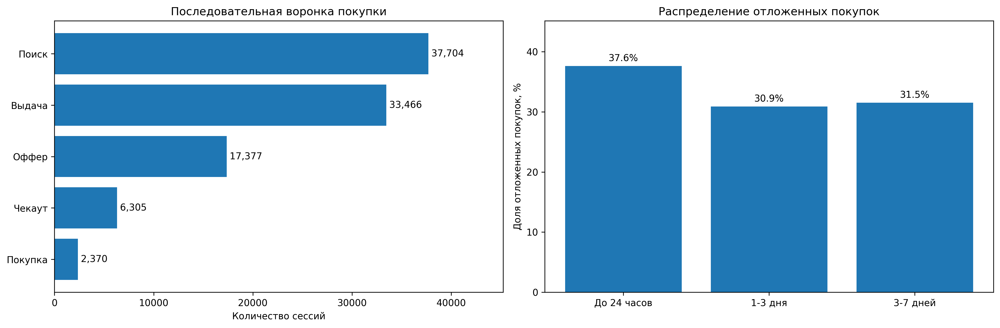

# Анализ воронки покупки авиабилетов и отложенной конверсии

Проект по продуктовой аналитике на Python: исследование пользовательских маршрутов, потерь на этапах покупки авиабилетов и повторных покупок в последующих сессиях.

**Материалы:** [Jupyter Notebook](avia_case.ipynb) · [Краткий отчёт (PDF)](report.pdf) · [Описание датасета (PDF)](case.pdf)

## Задача

Определить, на каких этапах пользователи перестают продвигаться к покупке, выяснить, насколько отсутствие покупки в одной сессии означает потерю клиента, и предложить проверяемые продуктовые улучшения.

## Ключевые результаты

| Показатель | Результат |
|---|---:|
| Данные | 244 345 событий, 38 561 сессия, 1 900 пользователей |
| Сессии с подтверждённой покупкой | 2 507 (6.50%) |
| Покупки, прошедшие строгую последовательную воронку | 2 370 из 2 507 (94.54%) |
| Снижение количества сессий на переходе «Оффер → Чекаут» | 63.72% |
| Пользователи с покупкой в последующие 7 дней после незавершённого чекаута | 327 из 1 284 (25.47%) |
| Возвращались в сервис в течение 7 дней | 907 из 1 284 (70.64%) |

Основные направления улучшения: **более прозрачное представление условий билета** и **возможность сохранить выбор для продолжения оформления в другой сессии**. Это продуктовые гипотезы, а не доказанные причины снижения конверсии.

*Слева - число сессий, последовательно достигших этапов. Справа - распределение времени до покупки среди пользователей, совершивших отложенную покупку за 7 дней.*

## Методология

- **Единица анализа воронки:** сессия. Покупка определяется по наличию заполненной `session_purchase_price`, а не по посещению технического экрана покупки.
- **Последовательная воронка:** `Поиск -> Выдача -> Оффер -> Чекаут -> Покупка`. События упорядочены по времени; повторные посещения допускаются. Из анализа порядка исключены 52 сессии с неоднозначными временными отметками.
- **Отложенные покупки:** для каждого пользователя рассматривается первая наблюдаемая сессия с чекаутом без покупки. Проверяются покупки в других сессиях за следующие 7 дней. Пользователи без полного окна наблюдения исключены.
- **Оценка бизнес-эффекта:** сценарное увеличение конверсии отдельного перехода на 1 процентный пункт при неизменной конверсии следующих этапов. Это не прогноз эффекта внедрения.

**Ограничение:** покупка в последующей сессии не обязательно относится к тому же билету, который пользователь выбирал ранее. Наблюдательные данные не позволяют устанавливать причины отказа от покупки.

## Данные и источник

Исследование выполнено по открытому учебному датасету **«Воронка авиабилетов»**, опубликованному в рамках **DANO 2025–2026**. Период данных согласно описанию источника: январь - сентябрь 2025 года.

- [Исходный Excel-файл](https://dano.hse.ru/mirror/pubs/share/1103375613.xlsx)
- [Описание датасета на сайте DANO](https://dano.hse.ru/mirror/pubs/share/1102777960.pdf)
- [Копия описания в репозитории](case.pdf)

Исходный Excel-файл намеренно не добавлен в репозиторий: ноутбук загружает его напрямую из публичного источника.
